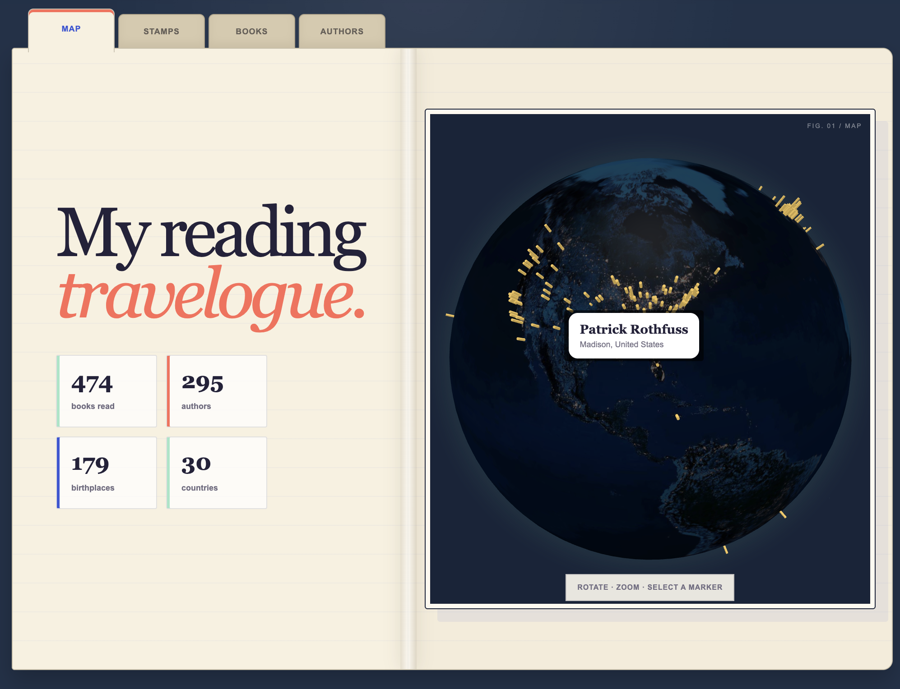

# My Reading Travelogue

My Reading Travelogue turns a Goodreads library export into an interactive globe and reading log of author birthplaces.



## Run locally

Requires Node.js 22.13 or newer.

```bash
npm install
npm run dev
```

Open the local URL shown in the terminal, then drop in the CSV from Goodreads’ **Export Library** page. Only books on the `read` shelf are included.

## How it works

- Parses the Goodreads CSV in the browser.
- Looks up each author through exact Wikidata labels, fuzzy entity search, and Wikipedia book-title evidence.
- Uses the author’s Wikidata birthplace and enriches missing coordinates from linked Wikipedia places.
- Stores a versioned local dataset of books and authors in browser storage.
- Links books to authors with Goodreads IDs when present, otherwise stable ISBN/name keys.
- Saves Goodreads and Wikidata IDs on author records for future enrichment.
- Stores confirmed identities in the shared author dataset even when birthplace data is still missing.
- Excludes translators, editors, illustrators, narrators, and unverified additional contributors from author counts.
- Expands known collective pen names into their individual writers through an extensible mapping.
- Asks you to verify when a search returns multiple plausible authors.
- Renders locations on a fully interactive Three.js globe with `globe.gl`.

The library is stored in browser storage on this device, while confirmed author identities and birthplace records are shared through the app database. Use **Export travelogue** to download the complete local dataset as JSON.

Every author uses an app-owned `author:<uuid>` primary ID. Goodreads and Wikidata IDs are retained as external identifiers rather than acting as primary keys. This allows two distinct authors to have the same display name and keeps identity independent from any external service. Each identity and birthplace field also records whether it was source-verified or user-contributed.

Author lookup responses are cached in the app database for 30 days. Incrementing `AUTHOR_LOOKUP_VERSION` invalidates old resolver results when matching behavior changes; ordinary UI changes should not increment it.

Older Goodreads exports do not include author IDs. In those files, authors are initially matched by a normalized name. The included sample format also represents “read” as a blank `Shelves` value; `to-read` and `currently-reading` rows are excluded.

## Commands

- `npm run dev` — start the local app
- `npm run build` — create a production build
- `npm test` — build and verify the rendered app shell
